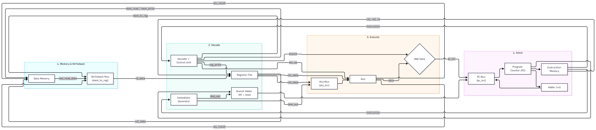
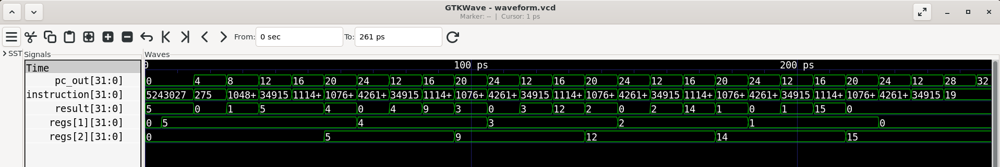

# RISC-V RV32I Mini Core Processor

[](https://github.com/kata2208/RISCV_CPU/actions/workflows/test.yml)

A single-cycle RISC-V (RV32I subset) 32-bit processor core written in SystemVerilog as a personal project to explore computer architecture and native RTL verification flows. Targeted for high-speed simulation with Verilator and designed with an eventual RTL-to-GDSII ASIC implementation flow in mind.

---

## Datapath Architecture

The processor implements a single-cycle von Neumann architecture with decoupled instruction and data memory interfaces.



---

## Key Features

* **ISA Coverage**: Core RV32I instructions:
  * **R-Type**: ADD, SUB, AND, OR, XOR, SLL, SRL
  * **I-Type**: ADDI, LW
  * **S-Type**: SW
  * **B-Type**: BEQ (Conditional Control Flow)
* **Modular RTL**: Clean separation between control unit, register file, immediate generator, ALU, and memory interfaces.
* **SystemVerilog Verification**: Self-checking unit testbenches and top-level integration tests.
* **Verilator Compliant**: Fully linted with zero width-mismatch or truncation warnings.

---

## Verification & Waveforms

All RTL modules are verified using isolated unit testbenches (`tb/tb_*.sv`) alongside end-to-end multi-cycle integration tests running hardware loops.

### GTKWave Trace (Hardware Loop Execution)
The execution trace below demonstrates a hardware loop computing the sum of numbers from 1 to 5 ($\sum_{i=1}^{5} i = 15$). It illustrates register values updating dynamically and branching back until the loop counter reaches zero.



---

## Future Enhancements

* Implement remaining RV32I control flow instructions (`JAL`, `JALR`, `BNE`, `BLT`).
* Add `$readmemh` support in instruction memory to load compiled binaries directly.
* Transition from a single-cycle core to a classic 5-stage pipeline (IF, ID, EX, MEM, WB).

---

## How to Build & Run

### Prerequisites
* Linux / WSL2 (Ubuntu)
* Verilator (>= 5.0)
* GTKWave (optional for waveform visualization)

### 1. Run Top-Level Integration Test
```bash
verilator --binary --trace --top-module tb_cpu -Irtl rtl/*.sv tb/tb_cpu.sv
./obj_dir/Vtb_cpu